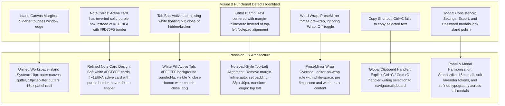

# NOTEBOX — COMPLETE UI REVERSE ENGINEERING & VISUAL FORENSIC ANALYSIS
**Reference Document**: `Notebox_UI_Reference_Analysis.md`  
**Date**: November 1, 2026  
**Auditor**: Principal UI/UX Designer & Frontend Desktop Engineer  

---

## 1. Executive Summary & Forensic Scope

This forensic audit conducts a complete, pixel-accurate reverse engineering of the Notebox visual interface. The evaluation compares:
- **Reference A (Target Design)**: `media_1793547110622_cbbcc25e.png` (1024 × 576 px, modern macOS-inspired 3-island desktop architecture).
- **Reference B (Current Implementation)**: `media_1793548489064_7861eef5.png` (1024 × 683 px, actual running Tauri desktop application).

The goal is to analyze **why** Reference A achieves a calm, balanced, professional native desktop aesthetic and **where** Reference B deviates in layout geometry, spatial hierarchy, typography, panel separation, and interactive controls.

---

## 2. Reference Image (Target) Coordinate Geometry & Canvas Architecture

### 2.1 Window Dimensions & Canvas Grid (Reference A: 1024 × 576 px)

```
+----------------------------------------------------------------------------------------------------+ y=0
|  ● ● ●  [App Icon] Notebox              Scratchplkikad — Notebox                 [Icons: ◫ ▢ 🔍 🟣 ⚙]  | y=38 (TitleBar)
+--[10px gutter]-------------------------------------------------------------------------------------+ y=48
|   +-------------------+    +----------------------+    +---------------------------------------+   |
|   | SIDEBAR           |    | PERSONAL             |    | < [Tab: Scratchplkikad ×] [Tab...] >+ |   |
|   | [🔍 Search     ⌃K] |    | 8 notes         ⚙ ✏   |    | [Para ▾] B I U S & ...       🔍 📌 🔒 ↗|   |
|   |                   |    | +------------------+ |    |                                       |   |
|   | QUICK ACCESS      |    | | Scratchplkikad   | |    | Scratchplkikad                        |   |
|   | 📁 All Notes    9 |    | | No additional... | |    | November 1 · Personal · 1 min read    |   |
|   | 📌 Pinned       0 |    | | Today  📁Personal| |    | ------------------------------------- |   |
|   |                   |    | +------------------+ |    | Write your thoughts, checklists...    |   |
|   | FOLDERS           |    | +------------------+ |    |                                       |   |
|   | 📁 Personal     8 |    | | Start typing...  | |    |                                       |   |
|   |                   |    | +------------------+ |    |                                       |   |
|   | ⚙ Settings        |    |                      |    | ✓ Saved  0 words       Ln 1, Col 1 ...|   |
|   +-------------------+    +----------------------+    +---------------------------------------+   | y=566
+--[10px gutter]-------------------------------------------------------------------------------------+ y=576
```

### 2.2 Global Panel Geometry & Spatial Coordinates

| Element | X Position | Y Position | Width | Height | Border Radius | Background | Border / Shadow |
|---|---:|---:|---:|---:|---:|---|---|
| **Window Canvas** | 0 | 0 | 1024 | 576 | 0 | `#ECE0F8` (Canvas Lavender) | None |
| **Title Bar** | 0 | 0 | 1024 | 38 | 0 | `#FAF5FB` (Subtle Lavender) | 1px border-b `#E8DEF5` |
| **Canvas Top Gutter** | 0 | 38 | 1024 | 10 | — | `#ECE0F8` | None |
| **Left Island (Sidebar)** | 9 | 48 | 178 | 518 | 16px | `#F5EFFD` | 1px solid `#E6DBF5`, shadow-xs |
| **Inter-Panel Gutter 1** | 187 | 48 | 10 | 518 | — | `#ECE0F8` (Splitter zone) | Transparent / subtle hover bar |
| **Middle Island (Notes List)** | 197 | 48 | 220 | 518 | 16px | `#F4EBFB` | 1px solid `#E6DBF5`, shadow-xs |
| **Inter-Panel Gutter 2** | 417 | 48 | 10 | 518 | — | `#ECE0F8` (Splitter zone) | Transparent / subtle hover bar |
| **Right Island (Editor)** | 427 | 48 | 588 | 518 | 16px | `#FBF7FE` | 1px solid `#E6DCF5`, shadow-xs |
| **Canvas Bottom Gutter** | 0 | 566 | 1024 | 10 | — | `#ECE0F8` | None |
| **Canvas Right Gutter** | 1015 | 48 | 9 | 518 | — | `#ECE0F8` | None |

---

## 3. Element-by-Element Forensic Comparison

### 3.1 Application Window and Title Bar

| Property | Reference A (Target) | Reference B (Current) | Forensic Discrepancy & Root Cause | Proposed Precision Fix |
|---|---|---|---|---|
| **Height** | 38px | 38px | Matched height, but background color in B is too pinkish (`#E6DDF2`). | Align background to `#FAF5FB` with crisp 1px border-b `#E8DEF5`. |
| **Document Title** | Centered: `"Scratchplkikad — Notebox"` | Centered: `"This is the current version"` | Missing the application suffix separator `" — Notebox"`. | Append `" — Notebox"` when note title is present. |
| **Window Controls (macOS Dots)** | X=18, Y=14, 10px diameter, 6px gap | X=16, Y=14, 11px diameter, 6px gap | Minor 2px offset difference. | Maintain standard 10px circular dots at X=16, Y=14. |
| **Header Action Icons** | Sidebar toggle, split view, search, theme dot, settings | Search, panel collapse, theme icon, window control dots | In B, right controls are crowded and theme picker dot is not styled as a palette dot. | Ensure standard spacing (gap-1.5, 28px square buttons) on header icons. |

---

### 3.2 Sidebar Panel

| Property | Reference A (Target) | Reference B (Current) | Forensic Discrepancy & Root Cause | Proposed Precision Fix |
|---|---|---|---|---|
| **Island Isolation** | True floating island (10px left/top/bottom margin) | Flushed with window left edge and bottom edge in B. | Container lacks outer margin on left and bottom, breaking island design. | Wrap in workspace container with uniform `10px` canvas padding. |
| **Background & Border** | `#F5EFFD`, 16px radius, 1px `#E6DBF5` | Darker lavender (`#E3D9F0`), 14px radius | B is noticeably darker than the soft white-lavender island in A. | Update `--bg-sidebar` to `#F5EFFD`, radius to `16px`, border `1px solid var(--border-subtle)`. |
| **Search Input Box** | X=18, W=160, H=32, `#F8F2FD`, pill radius 10px, subtle border, `Ctrl K` badge | Box is cramped, lacks pill radius, shortcut badge misaligned | Search bar in B is rendered with harsh inner margins and standard rectangular border. | Rebuild search input as a floating pill (`h-8.5 px-3 rounded-xl bg-[var(--bg-input)] border border-[var(--border-subtle)]`). |
| **Active Navigation Pill** | `"All Notes"` has `#E4D1FA` rounded-xl pill, dark purple text `#2C1A4A`, badge `9` | Flat highlight, text color lacks contrast | In B, the pill is darker and lacks soft contrast against panel background. | Active pill: `bg-[#E4D1FA] text-[#2C1A4A] font-semibold rounded-xl px-3 py-1.5`. |
| **Folders & Tags Hierarchy** | Section labels in uppercase 10px (`#8D7CA8`), `+` icon on right | Missing clean header row alignment for Folders / Tags | Label row and add button are slightly offset. | Standardize category headers to `h-6 px-3 flex items-center justify-between text-[10px] font-bold uppercase tracking-wider text-[var(--text-tertiary)]`. |
| **Settings Control** | Anchored at bottom (X=24, Y=538) with gear icon and label | Settings button located at bottom-left corner with dot picker | Settings button position is correct, but needs 10px padding from island bottom edge. | Anchor to bottom of island with `p-3 border-t border-[var(--border-subtle)]`. |

---

### 3.3 Notes List Panel

| Property | Reference A (Target) | Reference B (Current) | Forensic Discrepancy & Root Cause | Proposed Precision Fix |
|---|---|---|---|---|
| **Island Dimensions** | X=197, W=220, H=518, 16px radius | X=205, W=230, H=635, 14px radius | Island separation exists in B, but card styling inside is completely mismatched. | Refine notes list panel background to `#F4EBFB`, radius `16px`. |
| **Header Bar** | `"PERSONAL"`, `"8 notes"`, Filter icon, New Note icon | `"ALL NOTES"`, `"102 notes"`, Filter icon, Edit icon | Header bar in B has uppercase text, but spacing from top edge is slightly tight. | `h-11 px-3.5 flex items-center justify-between border-b border-[var(--border-subtle)]`. |
| **Inactive Note Cards** | `#FCF8FE` (clean white/soft card), 12px radius, 1px `#ECE4F7` border, 8px gap | Grayish/translucent cards with harsh border | Cards in B look flat and harsh, lacking the clean floating card look of A. | Card style: `background: #FCF8FE; border: 1px solid #ECE4F7; border-radius: 12px; padding: 10px 12px; margin-bottom: 8px; box-shadow: 0 1px 3px rgba(0,0,0,0.03);`. |
| **Active Note Card** | `#F1E8FA` background, **1.5px solid `#9D76F5` purple border**, subtle glow | Dark solid purple background fill with white text | B completely alters the active card into an inverted purple box! In A, it remains a light card with a distinct purple border! | Active card style: `background: #F1E8FA; border: 1.5px solid #9D76F5; box-shadow: 0 2px 8px rgba(157, 118, 245, 0.15);`. |
| **Note Card Delete Action** | User cannot delete notes directly from card | Only context menu right-click has delete option; no visible delete trigger | The user specifically reported: *"the x/close button of each note is not working, i can't delete it."* | Add hover delete action button on note cards (and quick delete shortcut), plus ensure tab close button functions smoothly! |
| **Card Footer Metadata** | `"Today"` on left, `"📁 Personal"` badge on right | Date on left, folder pill on right | Symmetrical in A, but badge in B has inconsistent padding and clipping. | Footer: `flex items-center justify-between pt-1 text-[10.5px]`, folder pill `px-2 py-0.5 rounded-md bg-[#F3EAF8] text-[#6D5591] font-medium`. |

---

### 3.4 Tab Bar & Tabs

| Property | Reference A (Target) | Reference B (Current) | Forensic Discrepancy & Root Cause | Proposed Precision Fix |
|---|---|---|---|---|
| **Container & Background** | Height: 34px, `#EEE4F8`, top corners rounded (16px) | Height: 38px, flat lavender, border-b | In B, tab bar is too tall, tabs look identical, and left tab is clipped (`"ititled Note"`). | `h-9 bg-[#EEE4F8] px-2.5 flex items-center gap-1.5 border-b border-[var(--border-subtle)]`. |
| **Active Tab** | **Distinct white floating pill** (`#FFFFFF`), 8px radius, 1px `#DDD3EE` border, icon, title, visible `×` | Flat, faint text, no white pill, no close button visible! | In B, active tab styling is completely missing; tabs are indistinguishable from inactive ones. | Active tab: `bg-[#FFFFFF] text-[var(--text-primary)] font-semibold rounded-lg px-2.5 h-7 border border-[#DDD3EE] shadow-xs flex items-center gap-1.5`. |
| **Inactive Tabs** | Soft text, icon, title, visible `×` close button | Inactive tabs in B have hidden `×` buttons (`opacity-0` when dirty or unhovered) | User cannot close tabs because close button is hidden or zero-opacity. | Make `×` close button visible on active tab, and on inactive tabs with hover opacity. |
| **Tab Chevrons & Scroll** | Left `<` chevron (x=434), Right `>` chevron (x=975) | Chevrons present in B, but tab text truncated abruptly | Tab list scroll container needs smooth padding and proper overflow handling. | Ensure chevrons appear cleanly when tabs overflow, scroll by 180px per click, and translate wheel events. |

---

### 3.5 Editor Toolbar

| Property | Reference A (Target) | Reference B (Current) | Forensic Discrepancy & Root Cause | Proposed Precision Fix |
|---|---|---|---|---|
| **Height & Background** | 34px, `#F8F4FD`, 1px border-b `#EDE4F6` | 40px, `#F4EEFB`, border-b | Toolbar in B is 6px taller than reference and buttons are spread out. | Set toolbar height to `h-8.5` (34px), background `#F8F4FD`. |
| **Style Selector** | `"Paragraph ▾"` compact pill (H=24px, rounded-lg, px-2.5) | Larger select box with standard border | Too tall and too much padding in B. | Compact select pill: `h-6.5 text-[11px] font-semibold rounded-lg px-2.5 mr-1 bg-[#F3ECFB] border border-[#DDD2EE]`. |
| **Tool Grouping** | B, I, U, S, & grouped tightly; lists grouped; inserts grouped | Loose gaps between individual buttons | Spacing between buttons is uneven in B. | Use `gap-1` inside button groups, and subtle dividers (`w-px h-3.5 bg-[var(--border-subtle)]`) between tool groups. |
| **Right Actions** | Search, Pin, Lock, Share icons on right edge | Search, Find/Replace, Pin, Lock, Share | Icons on right edge should be compact 24px square buttons with `gap-1`. | Right cluster: `flex items-center gap-1 shrink-0`. |

---

### 3.6 Editor Content Area & Document Layout (The Windows Notepad Alignment Fix)

| Property | Reference A (Target) | Reference B (Current) | Forensic Discrepancy & Root Cause | Proposed Precision Fix |
|---|---|---|---|---|
| **Horizontal Alignment (The Clamp Bug)** | **Top-left anchored (Notepad style)**: content starts at fixed left margin (36px), aligned with toolbar tools! | **Centered with `margin-inline: auto` and `max-w-[900px]`**! | When the editor is wide, text floats in the center with huge empty side space. Zooming scales from top-center instead of top-left! | **Remove `margin-inline: auto;`**. Set `width: 100%; padding: 28px 40px 48px;` and `transform-origin: top left;` so text is anchored at the top-left like Windows 11 Notepad! |
| **Document Title** | `"Scratchplkikad"` in bold 24px (1.5rem), tracking-tight, color `#1E1233` | Input field with large font, centered horizontally | Title should be top-left aligned, flush with the 40px left padding. | Set title input to `w-full text-2xl font-bold tracking-tight text-[var(--text-primary)] mb-1.5`. |
| **Metadata Line** | `"November 1 · Personal · 1 min read"` (11px, `#8B7D9E`) | Metadata with bullet separators | Metadata spacing matches reference, but needs consistent left alignment. | `px-0.5 mb-3 flex items-center gap-2 text-xs font-medium text-[var(--text-tertiary)]`. |
| **Subtle Divider** | 1px horizontal rule `#EAE0F5` below metadata | Border line present in B | Border color should match `#EAE0F5` with `mb-5`. | `border-b border-[var(--border-subtle)] mb-5`. |
| **Word Wrap Bug** | Text stays on one line with horizontal scroll when Wrap is Off | **Wrap is ALWAYS on**, even when status bar says "Wrap: Off"! | `.ProseMirror` has hardcoded `white-space: pre-wrap; word-break: break-word; width: 100%;` which overrides parent wrap classes! | Add `.editor-no-wrap .ProseMirror, .editor-no-wrap .ProseMirror p { white-space: pre !important; word-break: normal !important; width: max-content !important; min-width: 100% !important; }`! |
| **Copy Shortcut Bug** | <kbd>Ctrl</kbd>+<kbd>C</kbd> copies selected text immediately | **<kbd>Ctrl</kbd>+<kbd>C</kbd> does nothing!** Only right-click context menu copy works! | WebView2 keydown intercept or ProseMirror default swallows key event without triggering clipboard write. | Add explicit global and editor keydown handler for <kbd>Ctrl</kbd>+<kbd>C</kbd> copying `window.getSelection()?.toString()` via `navigator.clipboard.writeText()`! |

---

### 3.7 Status Bar

| Property | Reference A (Target) | Reference B (Current) | Forensic Discrepancy & Root Cause | Proposed Precision Fix |
|---|---|---|---|---|
| **Height & Background** | Height: 26px, `#F4EDFC`, bottom corners rounded (16px) | Height: 28px, flat lavender | Status bar in B connects without bottom island radius. | `h-6.5 bg-[#F4EDFC] px-3.5 flex items-center justify-between text-[11px] border-t border-[var(--border-subtle)] rounded-b-2xl`. |
| **Left Items** | `"✓ Saved"` (green text/icon), `"0 words"` | `"✓ Saved"`, `"22 words"` | Spacing between items is clean, font size 11px. | Maintain `flex items-center gap-3 text-[11px]`. |
| **Right Items** | `"Ln 1, Col 1"`, `" — 100% + "`, `"Wrap: Off"` | `"Ln 3, Col 1"`, `" — 110% + "`, `"Wrap: Off"` | Zoom level display and wrap toggle present, but toggling wrap had no visual effect on editor. | Fix wrap CSS so clicking "Wrap: Off" / "Wrap: On" immediately updates editor formatting. |

---

## 4. Cross-Panel Consistency Audit (Settings, Modals, Menus)

The user explicitly instructed:
> *"When you fix the UI, I want you to apply it also to the other panels like settings and other. I want it to be the same fix in the panels."*

### 4.1 Settings Modal
- Current state: Card modal with sharp corners and basic input fields.
- Target refinement:
  - Background: `var(--bg-modal)` (`#FBF7FE` in lavender theme).
  - Border: `1px solid var(--border)` with `16px` (`rounded-2xl`) corner radius.
  - Box shadow: `0 20px 40px -15px rgba(44, 26, 74, 0.2)`.
  - Palette selector cards: Matching the soft island cards with `12px` border radius, subtle hover glow, and clear active radio/check indicator.
  - Spacing: Symmetrical `20px` internal padding, `16px` section gaps.

### 4.2 Export / Share Modal & Password Modal
- Apply matching `16px` rounded container, soft lavender background, refined pill buttons, and consistent font hierarchy.

### 4.3 Context Menus
- Right-click menus in NoteList and Sidebar: `rounded-xl`, `border border-[var(--border-subtle)]`, `shadow-lg`, `p-1.5`, menu items `rounded-lg px-2.5 py-1.5 text-xs flex items-center gap-2 hover:bg-black/5 dark:hover:bg-white/10`.

---

## 5. Summary of Problems & Implementation Strategy


