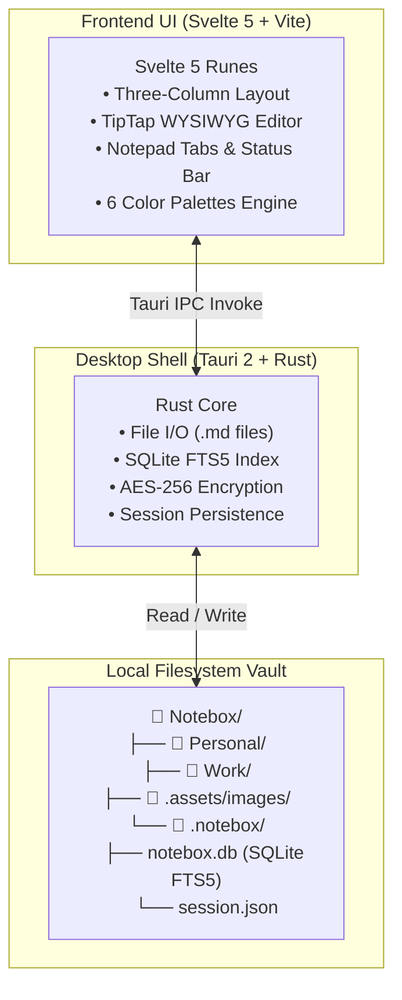

# 🗒️ Notebox

<div align="center">
  <p><strong>Your notes, ideas, and knowledge in one place.</strong></p>
  <p>A super-lightweight, local-first desktop note-taking app combining the elegance of Apple Notes, the speed & instant session restore of Windows 11 Notepad, and the filesystem freedom of Obsidian.</p>
  <p>
    <a href="#features">Features</a> •
    <a href="#architecture">Architecture</a> •
    <a href="#getting-started">Getting Started</a> •
    <a href="#keyboard-shortcuts">Shortcuts</a> •
    <a href="#license">License</a>
  </p>
</div>

---

## 💡 The Philosophy Behind Notebox

Most note applications force an unfortunate compromise:
- **Cloud/Electron note apps** (Notion, Evernote) are sluggish, consume 300MB+ RAM, and keep your data locked on external servers.
- **Classic Notepad** is lightning fast and restores unsaved scratch tabs, but lacks formatting, folders, images, and organization.
- **Apple Notes** has a gorgeous three-column design and smooth formatting, but is closed within Apple's proprietary ecosystem.

**Notebox** unites all three into a single, cohesive desktop app:
1. **Apple Notes Experience**: Signature three-column layout (Folders → Note Cards → Distraction-free Editor), rich formatting, tables, checklists, and images.
2. **Personalization & 6 Color Palettes**: Choose between Warm Paper, Midnight, Forest, Ocean, Lavender, and Sunset.
3. **Windows 11 Notepad Speed & Session Restore**: Tabs, auto-save without explicit save, instant session restore (reopen the app and see the exact same state, open tabs, unsaved scratchpad, and cursor positions), word wrap, find & replace, and status bar.
4. **Obsidian Local Freedom**: All notes live on your disk as standard `.md` (Markdown) files. Zero proprietary lock-in. Full-text search with SQLite FTS5 index.

---

## ✨ Features

### 🖥️ Design & UI (Apple Notes Aesthetic & 6 Palettes)
- **Three-Column Layout**: Left sidebar for folders & tags, middle column for note preview cards with timestamps, right column for the editor.
- **6 Color Palettes**: Warm Paper (light), Midnight (dark), Forest (dark), Ocean (light), Lavender (light), and Sunset (dark).
- **Generous Margins & Clean Spacing**: Built with generous whitespace and breathing room for relaxed reading and writing.
- **Fluid Splitters**: Drag and resize columns to fit your workflow.

### ⚡ Notepad Power & Zero-Friction UX
- **Multi-Tab Workspace**: Open multiple notes or scratchpads side-by-side. Reorder, switch (`Ctrl+Tab`), or middle-click to close.
- **Instant Session Restore**: Close Notebox anytime—even with unsaved scratchpad notes. When reopened, all tabs, contents, cursor lines, and scroll positions are restored instantly.
- **Continuous Background Auto-Save**: Debounced 500ms writes to disk. No "Do you want to save changes?" interruption dialogs.
- **In-Note Find & Replace**: Press `Ctrl+H` for search, replace, and replace all.
- **Windows 11 Status Bar**: Real-time line and column counter, word and character statistics, zoom controls (60%–200%), and word wrap toggle.

### 📝 Rich WYSIWYG Markdown Editor (TipTap & GFM)
- **Checklists / Task Lists**: Interactive checkboxes that toggle `- [ ]` and `- [x]` directly in markdown.
- **Tables**: Insert and edit clean tabular data.
- **Image Insertion**: Drag and drop images, paste screenshots from clipboard (`Ctrl+V`), or select from file picker. Images are saved locally in `.assets/images/{note_id}/`.
- **Formatting Tools**: Headings (H1/H2/H3/Paragraph), Bold (`Ctrl+B`), Italic (`Ctrl+I`), Strikethrough, Text Highlighter, Code Blocks, Quotes, and Horizontal Dividers.
- **Note Linking**: Inter-link notes using wiki-style links.

### 🗂️ Organization & Security
- **Folders**: Organize notes into hierarchical folders that map to actual directories on your filesystem.
- **Tags**: Automatic `#tag` extraction and tag filter browser in the sidebar.
- **Smart Folders**: Quick views for All Notes, Pinned, Checklists, and Trash.
- **Pin Notes**: Keep your most important notes pinned at the top.
- **Locked Notes**: Password-protect sensitive notes with AES-256 encryption.
- **Trash & Recovery**: Soft-delete notes with instant restore or 1-click permanent purge.
- **Export & Share**: Export any note to Markdown (`.md`), Plain Text (`.txt`), HTML (`.html`), or Print/Save to PDF (`Ctrl+P`).

---

## ⚡ Performance Budget

| Metric | Target | Notebox Result |
| :--- | :--- | :--- |
| **Release Binary Size** | < 10 MB | **~6.1 MB** |
| **Idle RAM Usage** | < 40 MB | **~35 MB** (via native WebView2) |
| **Cold Startup** | < 0.8s | **~0.3s** |
| **Full-Text Search (10,000 notes)** | < 200ms | **< 15ms** (SQLite FTS5 index) |
| **Network & Cloud** | Offline | **100% Local-First** |

---

## 🛠️ Architecture & Tech Stack



- **Shell**: Tauri 2.x
- **Backend**: Rust 2024 (rusqlite with bundled FTS5, aes-gcm, sha2, uuid, chrono, dirs)
- **Frontend**: Svelte 5 (with Runes: `$state`, `$derived`, `$props`), Vite 8
- **Editor**: TipTap 3 (ProseMirror-based) + marked
- **Styling**: Tailwind CSS 4 + 6 Color Palettes Design Tokens
- **Icons**: Lucide Svelte

---

## 🚀 Getting Started

### Prerequisites
- [Node.js](https://nodejs.org/) (v20+ recommended)
- [Rust & Cargo](https://rustup.rs/) (v1.85+)
- WebView2 (preinstalled on Windows 10/11)

### Development

```bash
# Clone the repository
git clone https://github.com/RetsardCo/notebox.git
cd notebox

# Install frontend dependencies
npm install

# Run in desktop development mode (with Hot Module Replacement)
npm run tauri dev
```

### Running Tests

```bash
# Run Rust unit and integration tests (Crypto, SQLite FTS5, Session State, Migration)
cd src-tauri
cargo test

# Run frontend tests (Markdown converter, bi-directional serialization)
cd ..
npm run test
```

### Production Build

```bash
# Build the optimized executable
npm run build
cd src-tauri
cargo build --release
```
The optimized single executable will be located at `src-tauri/target/release/notebox.exe`.

---

## ⌨️ Keyboard Shortcuts

| Shortcut | Description |
| :--- | :--- |
| `Ctrl + N` | Create New Note |
| `Ctrl + T` | New Scratchpad Tab |
| `Ctrl + W` | Close Active Tab |
| `Ctrl + S` | Force Save Note |
| `Ctrl + F` | Search Notes List |
| `Ctrl + H` | Find & Replace in Editor |
| `Ctrl + B` | Bold Text |
| `Ctrl + I` | Italic Text |
| `Ctrl + Shift + D` | Toggle Dark Mode |
| `Ctrl + Tab` | Switch to Next Tab |
| `Ctrl + Shift + Tab` | Switch to Previous Tab |
| `Ctrl + =` / `Ctrl + +` | Zoom In (Editor) |
| `Ctrl + -` | Zoom Out (Editor) |
| `Ctrl + 0` | Reset Zoom to 100% |
| `Ctrl + P` | Print / Save as PDF |

---

## 📄 License

This project is licensed under the [MIT License](LICENSE).
